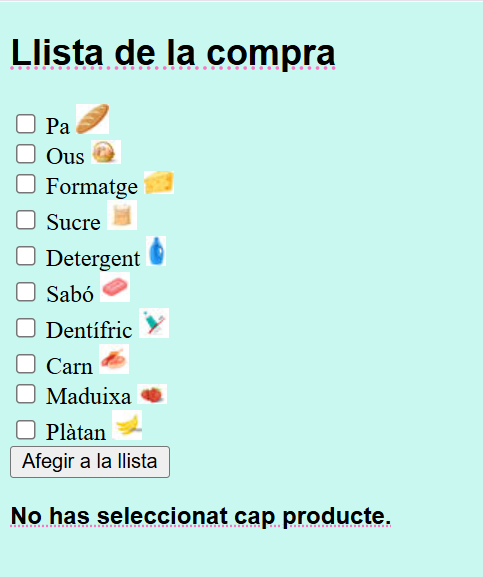
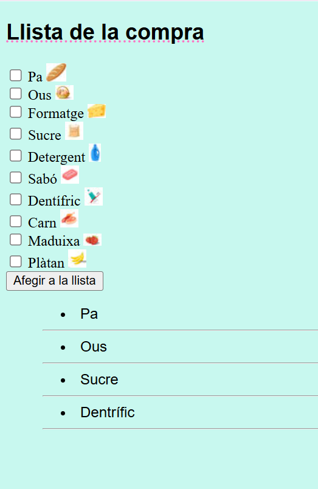

# Lista de la Compra Básica

Una aplicación web muy sencilla para gestionar una lista de la compra, desarrollada únicamente con PHP y CSS.

## Descripción

Este proyecto es una práctica básica de PHP y CSS. Consiste en una página web en la que se muestra un listado de productos disponibles. El usuario puede seleccionar los productos que desee mediante casillas de verificación (checkboxes) y pulsar un botón para añadirlos a la lista de la compra.

Si el usuario pulsa el botón de añadir sin haber seleccionado ningún producto, la aplicación muestra un mensaje de aviso: **"No has seleccionat cap producte"**.

## Características

- 🛒 **Listado de productos:** Muestra los productos disponibles en la tienda.
- ☑️ **Selección de productos:** Permite marcar uno o varios productos mediante checkboxes.
- ➕ **Añadir a la lista:** Botón para añadir los productos seleccionados a la lista de la compra.
- 📋 **Lista dinámica:** En la parte inferior se muestra la lista con los productos añadidos.
- ⚠️ **Mensaje de aviso:** Si no se selecciona ningún producto y se pulsa el botón, aparece el mensaje "No has seleccionat cap producte".

## Tecnologías utilizadas

- **PHP:** Para la lógica del servidor y el procesamiento del formulario.
- **HTML:** Para la estructura de la página.
- **CSS:** Para el diseño y los estilos visuales.

## Requisitos

Para ejecutar este proyecto en tu ordenador necesitas:

- Un servidor local como **XAMPP**.
- Un navegador web (Chrome, Firefox, Edge, etc.).

## Capturas de pantalla

## Autor

- **[Mamen Busquets]** - [MamenBusquets](https://github.com/MamenBusquets)